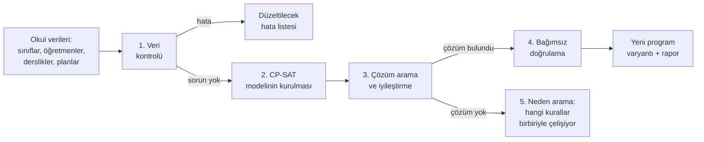

# Ders Dağılım Algoritması Nasıl Çalışır?

Bu belge, programın okul verilerinden ders programını nasıl hazırladığını ayrıntılı olarak açıklar: neyi hesapladığını, hangi kurallara uyduğunu, en iyi programı nasıl seçtiğini ve program hazırlanamıyorsa ne yaptığını.

Rusça sürüm: [ALGORITM_RU.md](ALGORITM_RU.md) · Kullanım kılavuzu: [KULLANIM_KILAVUZU_TR.md](KULLANIM_KILAVUZU_TR.md)

---

## 1. Temel fikir

Ders programı çok büyük bir bulmacadır. Okulda 42 sınıf ve grup, yaklaşık 550 sınıf dersi ve haftada 1552 ders saati vardır; tablo 16 yarım saatlik ders × 5 gündür. Olası yerleşimlerin sayısı evrendeki atom sayısından fazladır. Bu yüzden hepsini denemek imkânsızdır; dersleri "sırayla ilk boş hücreye" koymak da neredeyse her zaman çıkmaza girer veya kötü bir program üretir.

Bu nedenle program bir matematikçi gibi çalışır:

1. **Okulun kurallarını matematiksel bir model olarak yazar**: "evet/hayır" değişkenleri, eşitlikler ve eşitsizlikler.
2. **Modeli Google OR-Tools CP-SAT çözücüsüne verir.** CP-SAT; ders programı, vardiya planı ve lojistik gibi kısıtlı problemler için dünyanın en güçlü ücretsiz çözücülerinden biridir.
3. Çözücü önce **tüm zorunlu kuralların sağlandığı** bir program bulur, sonra karşılanmayan tercihlerin "ceza puanını" azaltarak programı **iyileştirir**.

---

## 2. Adım 1 — Veri kontrolü (`app/core/validator.py`)

Hesaplamadan önce giriş verilerindeki belirgin hatalar aranır. Bunlar varken hesaplama başlamaz:

| Kontrol | Örnek mesaj |
|---|---|
| Sınıfın öğretim planı veya dersi yok | "AMP9A: sınıfa öğretim planı atanmamış" |
| Ders saati, sınıfın boş saatinden fazla | "AMP9A: haftalık 45 saat ders var, ancak müsait zamanı 30 saat" |
| Dersi verebilecek öğretmen yok | "AMP10A – Fizik: bu dersi verebilecek öğretmen yok" |
| Zorunlu derslik yok | "… uygun derslik yok (tür veya kapasite)" |
| Saatler blok kurallarına göre sınıfın günlerine bölünemiyor | "… bölünmeler sınıfın okul gününe sığmıyor" |
| Öğretmenin zorunlu dersleri sınırından veya boş zamanından fazla | "X: zorunlu ders yükü 34 saat, haftalık sınırı 30" |
| Dersliğe olan ihtiyaç, kapasiteyle birlikte boş zamanından fazla | "BT1: ihtiyaç 52 saat, müsait zamanı 45 saat" |

Ayrıca hesaplamayı engellemeyen **uyarılar** verilir: örneğin hiç dersi olmayan öğretmen veya birden fazla sınıfa atanmış derslik.

---

## 3. Adım 2 — Model: program neyi "çözer"?

### 3.1 Sınıf dersi
Her "sınıf (veya grup) × ders" çifti için bir **ders** k oluşturulur. Bu ders şunları bilir:
- haftalık saati (HDS);
- kimin verebileceği: seçilecek bir öğretmen veya derse **aynı anda giren bir ekip**;
- nerede yapılabileceği: seçilecek bir derslik veya gruplar için **aynı anda kullanılan tüm derslikler**;
- art arda bloklara nasıl bölünebileceği, ör. 9 = 3+3+3;
- hangi sınıfların bu dersi aldığı: genelde bir sınıf, **birleştirilmiş derste** birden fazla (ör. BDÇ10, ATP10A-1 ve ATP10A-2 birlikte).

### 3.2 Değişkenler ("evet/hayır" soruları)

| Değişken | Soru |
|---|---|
| `s[k, L, d, p]` | k dersinin L saatlik bir bloğu d gününde p. derste mi başlıyor? |
| `z[k, bölünme]` | k dersi için bu bölünme (ör. 3+3+3) mi kullanılıyor? |
| `y[k, t]` | k dersini t öğretmeni mi veriyor? (Birden fazla uygun öğretmen varsa.) |
| `r[k, blok, derslik]` | k dersinin bu bloğu bu derslikte mi? (Seçilecek birden fazla derslik varsa.) |

Bu değişkenlerden şu değerler hesaplanır:
- **dersin doluluğu** `occ[k, d, p]` = 1, k dersi d gününün p. dersinde yapılıyorsa. Bu değer, o hücreyi kapsayan blokların toplamıdır;
- **öğretmen** ve **derslik doluluğu**: içinde yer aldıkları derslerin doluluklarının toplamı.

Değişkenler yalnızca dersin konabileceği hücreler için oluşturulur. Örneğin sınıf pazartesi işletmedeyse o sınıf için pazartesi değişkeni yoktur. Böylece model küçülür ve daha hızlı çözülür. Okul için yaklaşık **63.000 değişken** ve **25.000 kısıt** oluşur.

---

## 4. Zorunlu kurallar (sert kısıtlar, `app/core/constraints.py`)

Bu kurallar **asla** ihlal edilmez. Hepsi birlikte sağlanamıyorsa program oluşturulmaz.

| No | Kural | Modeldeki karşılığı |
|---|---|---|
| 1 | Sınıfın aynı saatte en fazla bir dersi olur | her sınıf ve hücre için: Σ occ ≤ 1 |
| 2 | Grup ile ana sınıfın aynı saatte dersi olmaz | occ(sınıf) + occ(grup) ≤ 1 |
| 3 | Öğretmen aynı saatte iki derse girmez | öğretmen ve hücre için: Σ doluluk ≤ 1 (birleştirilmiş ders tek derstir) |
| 4 | Derslik kapasitesi aşılmaz | Σ derslik doluluğu ≤ "Aynı anda en fazla ders" (genelde 1, büyük atölyelerde 2) |
| 5 | Haftalık saat tam olarak yerleşir | Σ (L × s[k,L,·,·]) = dersin HDS'si |
| 6 | Bloklara bölünme kurallara uygundur | tam olarak bir z seçilir; her uzunluktaki blok sayısı bölünmeyle aynıdır |
| 7 | İzin yoksa günde bir blok; bloklar bitişik olmaz | günlük blok sayısı ≤ 1 veya blok başka bir bloğun hemen ardından başlamaz |
| 8 | Dersi uygun öğretmen verir | uygun öğretmenlerden tam olarak bir y[k,t] = 1; ekip her zaman tamdır |
| 9 | Sınıfın, öğretmenin ve dersliğin kapalı saatleri | bu hücreler için değişken oluşturulmaz |
| 10 | Gerekli derslik türü | yalnızca uygun derslikler arasından seçim yapılır |
| 11 | Öğretmen sınırları | günlük ders ≤ sınır, haftalık ders ≤ sınır (ve tanımlıysa ≥ en az) |
| 12 | Sınıfın günlük ders sınırı | günlük Σ occ ≤ sınır |
| 13 | Kilitli 🔒 dersler | bu hücrelerde occ = 1; öğretmen ve derslik kilitlendiği gibi kalır |
| 14 | İşletmelerde Mesleki Eğitim | sınıfın zamanını doldurur; öğretmen ve derslik gerekmez |

---

## 5. Tercihler ve ceza puanı (yumuşak kısıtlar, `app/core/optimizer.py`)

Bölüm 4'teki kuralları genelde milyonlarca program sağlar. **En iyisini** seçmek için her programa bir **ceza puanı** verilir ve çözücü en düşük puanlı programı arar:

> **Ceza = Σ ( öncelik × katsayı × ölçülen değer )**

- **Öncelik (0–10)** "Ayarlar" bölümünden siz belirlersiniz. 0 = bu tercih dikkate alınmaz.
- **Katsayı** sabittir; farklı ölçü birimlerini dengeler ("bir boş saat" ile "bir ders sonra" farklı ağırlıktadır).

| Tercih | Ölçülen değer | Varsayılan öncelik | Katsayı | 1 birimin ağırlığı |
|---|---|---|---|---|
| Sınıf boş saatlerini azalt | sınıfın iki dersi arasındaki boş saat | 10 | 30 | 300 |
| Aynı branştaki öğretmenlerin yük dengesi | haftalık en çok − en az saat | 8 | 25 | 200 |
| Öğretmen boş pencerelerini azalt | öğretmenin iki dersi arasındaki boş saat | 8 | 12 | 96 |
| Tercih edilen blok bölünmesi | tercih edilen bölünme seçilmemiş | 6 | 20 | 120 |
| Bir günde çok fazla zor ders olmasın | sınırı aşan her zor ders saati | 6 | 15 | 90 |
| Sınıfın günlük yük dengesi | en yoğun gün − en hafif gün | 6 | 8 | 48 |
| Öğretmen için art arda çok ders olmasın | art arda sınırını aşan her saat | 5 | 10 | 50 |
| Öğretmenin tercih ettiği günler | tercih etmediği gündeki ders | 4 | 4 | 16 |
| Öğretmenin günlük yük dengesi | en yoğun gündeki ders sayısı | 3 | 3 | 9 |
| Zor dersler ilk saatlerde | ders sırası × zorluk (1 veya 2) | 7 | 2 | 14 |
| Beden eğitimi son saatlerde | günün sonuna kalan ders sayısı | 5 | 2 | 10 |
| Dersin tercih edilen zamanı | sabah / öğleden sonra tercihinden sapma | 5 | 2 | 10 |

### Boş pencere nasıl sayılır?
Her öğretmen (veya sınıf) ve gün için ilk ve son ders bulunur. Aradaki her boş ders saati bir **pencere** sayılır. Örneğin 1., 2. ve 5. derslerde dersi olan öğretmenin 3. ve 4. derste penceresi vardır; toplam 2.

### Hesaplama örneği
Bir matematik öğretmeninin tek bir günü için iki seçenek:

| | Seçenek A | Seçenek B |
|---|---|---|
| Öğretmenin dersleri | 1, 2, 5, 6 | 1, 2, 3, 4 |
| Boş pencere | 2 → 8 × 12 × 2 = **192** | 0 → **0** |
| 9A'nın matematiği | 5. derste → 7 × 2 × (4 × 2) = **112** | 3. derste → 7 × 2 × (2 × 2) = **56** |
| **Toplam** | **304** | **56** |

Çözücü B seçeneğini tercih eder. Tüm okulda binlerce böyle terim toplanır ve program toplamı en küçük yapan yerleşimi arar.

### Farklı bir sonuç istiyorsanız
"Ayarlar → Optimizasyon" bölümünde önemli tercihin önceliğini yükseltin veya istemediğinizi 0 yapın ve hesaplamayı yeniden çalıştırın. Örneğin "Beden eğitimi son saatlerde" önceliği 10 yapılırsa beden eğitimi dersleri günün sonuna daha çok yaklaşır.

---

## 6. Adım 3 — Çözücü programı nasıl bulur ve iyileştirir?

CP-SAT birkaç yöntemi birleştirir ve bunları işlemcinin **birden fazla çekirdeğinde paralel** çalıştırır (varsayılan 8 iş parçacığı):

1. **Ön işleme (presolve).** Gereksiz değişkenleri atar, kurallardan kesin çıkan sonuçları önceden sabitler, kısıtları sadeleştirir.
2. **Kısıt yayılımı (propagation).** Bir ders "yerleştirildiği" anda imkânsız hale gelen her şey hemen elenir: sınıfın o hücresi dolar, öğretmen o saatte meşgul olur, dersin kalan saati azalır.
3. **Çatışmadan öğrenen arama (SAT çözücülerdeki gibi).** Çözücü çıkmaza girerse **nedenini** bulur ve aynı hatayı tekrarlamamak için bunu yeni bir kural olarak kaydeder.
4. **Doğrusal gevşetme.** Ceza puanının bundan daha iyi olamayacağını gösteren bir **alt sınır** hesaplar; ekranda "alt sınır" olarak görünür. Mevcut ceza alt sınıra ne kadar yakınsa çözüm en iyiye o kadar yakındır.
5. **Yerel iyileştirmeler (LNS).** Bulunan programın bir kısmını (ör. bir günü veya bir grup öğretmeni) "serbest bırakır", geri kalanını sabit tutar ve o kısmı daha iyi yeniden kurar. Ceza puanı adım adım bu şekilde düşer.

**Mevcut programdan başlama.** "Etkin programı başlangıç noktası olarak kullan" işaretliyse mevcut program çözücüye ipucu olarak verilir. Çözücü sıfırdan aramak yerine iyi bir noktadan başlayıp onu iyileştirir.

**Süre.** Çözücü süre sınırına kadar veya en iyi çözümü kanıtlayana kadar çalışır. "Durdur" düğmesine basılırsa o ana kadar bulunan en iyi program kaydedilir; bu programda da tüm zorunlu kurallar sağlanır. Okul verileriyle ilk program yaklaşık 35 saniyede bulunur; 7 dakikada öğretmen boş pencereleri 293'ten 100'e iner.

---

## 7. Adım 4 — Bağımsız doğrulama (`app/core/conflicts.py`)

Bulunan program, çözücüden tamamen **ayrı bir denetleyici** ile kontrol edilir. Denetleyici tüm ders saatlerini tek tek gezerek bölüm 4'teki kurallarla karşılaştırır: sınıf, öğretmen ve derslik çakışmaları, ders saatleri, yetkinlik, kapalı saatler, sınırlar, gruplar. Aynı kontrol editörde **her elle değişiklikten sonra** da çalışır; elle düzenlemede yapılan bir hata hemen kırmızı çerçeveyle görünür.

---

## 8. Adım 5 — Program hazırlanamıyorsa

Bazen kurallar birbiriyle çelişir. Örneğin iki Türkçe öğretmeninin de pazartesi ve salı günleri kapalıdır, AMP12A sınıfı ise yalnızca bu günlerde okuldadır. Bu durumda program:

1. Bir **tanı modeli** kurar: her kural grubuna bir "anahtar" verilir, ör. "AMP12A–TDE ders saatleri", "X öğretmeninin kapalı saatleri", "AMP12A sınıfının günleri".
2. Çözücüden problemi çözümsüz bırakan **en küçük anahtar kümesini** (çelişki çekirdeği) bulmasını ister.
3. Bu kümeyi küçültür: her kuralı sırayla çıkarıp çelişkinin ortadan kalkıp kalkmadığını kontrol eder.
4. Sonucu anlaşılır bir metne çevirir:

> • Öğretmen Ayşe Yılmaz: kapalı saatleri (18 saat) ders yerleştirmeyi engelliyor.
> • Öğretmen Mehmet Öztürk: kapalı saatleri (18 saat) ders yerleştirmeyi engelliyor.
> • AMP12A sınıfının okul günleri/saatleri (18 saat müsait) yetersiz.
> • AMP12A sınıfının Türk Dili ve Edebiyatı dersi için 4 saat yerleştirilemiyor.

Kural ihlali içeren bir program **asla sessizce kaydedilmez**.

---

## 9. Okula özel durumlar

| Durum | Nasıl dikkate alınır? |
|---|---|
| **Yarım saatlik dersler (günde 16)** | tablo Ayarlar'da tanımlanır; modeldeki bir "saat" tablonun bir hücresidir |
| **Sınıfın ders saati aralığı** | sınıfın son dersinden sonraki hücreler kapatılır; vardiyalar "kaymaz" |
| **Şube grupları (ATP10A-1/2/3)** | ana sınıfa bağlı ayrı "sınıflardır"; herhangi bir grubun dersi varken ana sınıfın dersi olmaz; gruplar birbirleriyle aynı anda ders yapabilir |
| **Öğretmen ekibi (2Tİİ, 3BTT…)** | ekipteki tüm öğretmenler dersin her saatinde meşguldür |
| **Birden fazla derslik** | "hepsi aynı anda" — hepsi birlikte dolar; "birini seç" — her blok için biri seçilir |
| **Birleştirilmiş ders (BDÇ10)** | birden fazla grup için tek değişken; öğretmen ve derslik bir kez sayılır |
| **Büyük atölyeler (YG, 4PMA)** | kapasite 2: aynı anda iki derse izin verilir |
| **İşletmelerde Mesleki Eğitim** | "okul dışında" dersi: sınıfın günlerini doldurur, öğretmen ve derslik gerekmez |
| **Bloklara bölünme** | bölünmeler en kısa/en uzun bloktan otomatik üretilir veya açıkça yazılır (`3+3+3; 2+2+2+3`); aktarılan derslerde mevcut programdaki bölünmeye her zaman izin verilir |

---

## 10. Kodda nerede?

| Dosya | Görevi |
|---|---|
| `app/core/problem.py` | problemi veritabanından kurar: dersler, adaylar, hücreler, ekipler, gruplar, birleştirmeler |
| `app/core/splits.py` | saatlerin bloklara bölünme seçenekleri |
| `app/core/validator.py` | veri kontrolü (adım 1) |
| `app/core/constraints.py` | değişkenler ve zorunlu kurallar (adım 2) |
| `app/core/optimizer.py` | tercihler ve ceza formülü |
| `app/core/scheduler.py` | çözücünün çalıştırılması, ilerleme, durdurma, çözümsüzlüğün nedenleri |
| `app/core/conflicts.py` | bağımsız doğrulama (adım 4) |
| `app/core/workload.py` | raporlar: yükler, boş pencereler, derslik doluluğu |

Hazırlayan: Ramzan 25053 10 A
