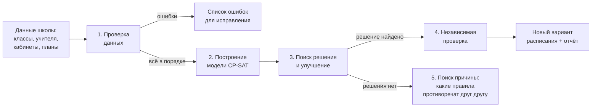

# Как работает алгоритм составления расписания

Документ подробно объясняет, как программа превращает данные школы в расписание: что она считает, какие правила соблюдает, как выбирает лучший вариант и что делает, если расписание составить невозможно.

Версия на турецком: [ALGORITMA_TR.md](ALGORITMA_TR.md) · Инструкция пользователя: [INSTRUKCIYA_RU.md](INSTRUKCIYA_RU.md)

---

## 1. Общая идея

Расписание — это огромная головоломка. В школе 42 класса и подгруппы, около 550 уроков класса и 1552 часа в неделю, 16 получасовых уроков × 5 дней. Число способов расставить уроки больше, чем атомов во Вселенной, поэтому перебрать всё невозможно, а расстановка «по порядку в первую свободную клетку» почти всегда заходит в тупик или даёт плохое расписание.

Поэтому программа работает как математик:

1. **Записывает правила школы как математическую модель** — систему переменных «да/нет», уравнений и неравенств.
2. **Отдаёт модель решателю** Google OR-Tools **CP-SAT**. Это один из сильнейших бесплатных решателей в мире для задач с ограничениями, такими как расписания, графики смен и логистика.
3. Решатель находит расписание, в котором **все обязательные правила выполнены**, а затем **улучшает** его, уменьшая «штраф» за нарушенные пожелания.

---

## 2. Шаг 1 — проверка данных (`app/core/validator.py`)

Ещё до расчёта программа ищет очевидные ошибки во входных данных. Расчёт не начнётся, пока они есть:

| Проверка | Пример сообщения |
|---|---|
| У класса нет учебного плана или предметов | «AMP9A: sınıfa öğretim planı atanmamış» |
| Часов больше, чем свободных клеток у класса | «AMP9A: haftalık 45 saat ders var, ancak müsait zamanı 30 saat» |
| У предмета нет ни одного подходящего учителя | «AMP10A – Fizik: bu dersi verebilecek öğretmen yok» |
| Обязательный кабинет отсутствует | «… uygun derslik yok (tür veya kapasite)» |
| Часы нельзя разбить по правилам блоков на дни класса | «… bölünmeler sınıfın okul gününe sığmıyor» |
| У учителя обязательных часов больше, чем лимит или свободное время | «X: zorunlu ders yükü 34 saat, haftalık sınırı 30» |
| Кабинет нужен дольше, чем он свободен с учётом вместимости | «BT1: ihtiyaç 52 saat, müsait zamanı 45 saat» |

Отдельно выдаются **предупреждения**, которые не мешают расчёту: например, у учителя нет ни одного урока или один кабинет закреплён за несколькими классами.

---

## 3. Шаг 2 — модель: что программа «решает»

### 3.1 Урок класса
Для каждой пары «класс (или группа) × предмет» создаётся **урок** k. Он знает:
- сколько часов в неделю (HDS);
- кто может его вести: один учитель на выбор или **команда**, которая ведёт урок вся сразу;
- где он может проходить: один кабинет на выбор или **все кабинеты сразу** для групп;
- как его можно делить на блоки подряд, например 9 = 3+3+3;
- какие классы его слушают: обычно один, а у **объединённого урока** несколько, например BDÇ10 у ATP10A-1 и ATP10A-2 одновременно.

### 3.2 Переменные (вопросы с ответом «да/нет»)

| Переменная | Вопрос |
|---|---|
| `s[k, L, d, p]` | Начинается ли блок урока k длиной L часов в день d на уроке p? |
| `z[k, вариант]` | Используется ли для урока k этот вариант деления, например 3+3+3? |
| `y[k, t]` | Ведёт ли урок k учитель t? Нужно, если подходит несколько учителей. |
| `r[k, блок, кабинет]` | Проходит ли этот блок урока k в этом кабинете? Нужно, если кабинетов на выбор несколько. |

Из этих переменных выводятся величины:
- **занятость урока** `occ[k, d, p]` = 1, если урок k идёт в день d на уроке p. Это сумма всех блоков, которые покрывают эту клетку;
- **занятость учителя** и **занятость кабинета** — суммы занятости уроков, где они участвуют.

Переменные создаются только там, где урок вообще может стоять. Например, если класс в понедельник на предприятии, переменных на понедельник для него нет. Так модель становится меньше и считается быстрее. Для школы получается около **63 000 переменных** и **25 000 ограничений**.

---

## 4. Обязательные правила (жёсткие ограничения, `app/core/constraints.py`)

Эти правила **никогда** не нарушаются. Если выполнить их одновременно нельзя, расписание не создаётся.

| № | Правило | Как записано в модели |
|---|---|---|
| 1 | У класса не больше одного урока одновременно | для каждого класса и клетки: Σ occ ≤ 1 |
| 2 | Подгруппа и основной класс не учатся одновременно | occ(класс) + occ(группа) ≤ 1 |
| 3 | Учитель не ведёт два урока одновременно | для учителя и клетки: Σ занятости ≤ 1 (объединённый урок — один урок) |
| 4 | Кабинет не переполнен | Σ занятости кабинета ≤ «Aynı anda en fazla ders» (обычно 1, у больших мастерских 2) |
| 5 | Ровно положенное число часов | Σ (L × s[k,L,·,·]) = HDS урока |
| 6 | Деление на блоки по правилам | выбирается ровно один вариант z; число блоков каждой длины совпадает с вариантом |
| 7 | Один блок предмета в день, если иное не разрешено; блоки не стоят вплотную | Σ блоков урока за день ≤ 1, или блок не начинается сразу после другого блока |
| 8 | Ведёт подходящий учитель | ровно один y[k,t] = 1 из подходящих; команда ведёт целиком |
| 9 | Закрытые часы класса, учителя и кабинета | переменные на эти клетки не создаются |
| 10 | Нужный тип кабинета | выбор только среди подходящих кабинетов |
| 11 | Лимиты учителя | уроков за день ≤ лимита, за неделю ≤ лимита (и ≥ минимума, если задан) |
| 12 | Лимит уроков класса в день | Σ occ за день ≤ лимита |
| 13 | Закреплённые 🔒 уроки | occ на этих клетках = 1, учитель и кабинет — как закреплено |
| 14 | Уроки на предприятии (İME) | занимают время класса, учитель и кабинет не нужны |

---

## 5. Пожелания и штраф (мягкие ограничения, `app/core/optimizer.py`)

Правилам из раздела 4 обычно удовлетворяют миллионы расписаний. Чтобы выбрать **лучшее**, каждому расписанию начисляется **штраф**, и решатель ищет расписание с наименьшим штрафом:

> **Штраф = Σ ( приоритет × коэффициент × измеренное значение )**

- **Приоритет (0–10)** задаёте вы в «Ayarlar». 0 — пожелание не учитывается.
- **Коэффициент** фиксирован. Он уравнивает разные единицы измерения: «одно окно» и «на один урок позже» весят по-разному.

| Пожелание | Что измеряется | Приоритет по умолч. | Коэфф. | Вес 1 единицы |
|---|---|---|---|---|
| Меньше окон у классов | пустой урок между уроками класса | 10 | 30 | 300 |
| Баланс нагрузки учителей одной специальности | макс. − мин. часов в неделю | 8 | 25 | 200 |
| Меньше окон у учителей | пустой урок между уроками учителя | 8 | 12 | 96 |
| Предпочитаемое деление на блоки | предпочитаемый вариант не выбран | 6 | 20 | 120 |
| Не больше N сложных уроков в день | каждый сложный час сверх лимита | 6 | 15 | 90 |
| Ровная нагрузка класса по дням | самый тяжёлый день − самый лёгкий | 6 | 8 | 48 |
| Не слишком много уроков подряд у учителя | каждый час сверх лимита подряд | 5 | 10 | 50 |
| Предпочитаемые дни учителя | урок в непредпочитаемый день | 4 | 4 | 16 |
| Ровная нагрузка учителя по дням | уроков в самый загруженный день | 3 | 3 | 9 |
| Сложные предметы в начале дня | номер урока × сложность (1 или 2) | 7 | 2 | 14 |
| Физкультура в конце дня | сколько уроков осталось до конца дня | 5 | 2 | 10 |
| Предпочитаемое время предмета | отклонение от «утро» / «после обеда» | 5 | 2 | 10 |

### Как считаются окна
Для каждого учителя (класса) и дня программа определяет первый и последний урок. Каждый пустой урок между ними — одно **окно**. Например: уроки на 1-м, 2-м и 5-м часу — окна на 3-м и 4-м, итого 2.

### Пример расчёта
Сравним два варианта для одного дня учителя математики:

| | Вариант A | Вариант B |
|---|---|---|
| Уроки учителя | 1, 2, 5, 6 | 1, 2, 3, 4 |
| Окна | 2 → 8 × 12 × 2 = **192** | 0 → **0** |
| Математика у 9A | на 5-м уроке → 7 × 2 × (4 × 2) = **112** | на 3-м уроке → 7 × 2 × (2 × 2) = **56** |
| **Итого** | **304** | **56** |

Решатель выберет вариант B. Во всей школе складываются тысячи таких слагаемых, и программа ищет расстановку с минимальной суммой.

### Если хочется другого результата
Поднимите приоритет важного вам пожелания или поставьте 0 ненужному в «Ayarlar → Optimizasyon» и запустите расчёт снова. Например, приоритет 10 у «Beden eğitimi son saatlerde» сильнее прижмёт физкультуру к концу дня.

---

## 6. Шаг 3 — как решатель находит и улучшает расписание

CP-SAT объединяет несколько методов и запускает их **параллельно на нескольких ядрах** процессора (по умолчанию 8 потоков):

1. **Упрощение модели (presolve).** Убирает лишние переменные, заранее фиксирует то, что следует из правил, и упрощает ограничения.
2. **Распространение ограничений (propagation).** Как только решатель «ставит» урок, он сразу вычёркивает всё, что стало невозможным: эта клетка для класса занята, учитель в это время занят, часов у предмета осталось меньше.
3. **Поиск с обучением на конфликтах (как в SAT-решателях).** Если решатель зашёл в тупик, он выясняет **причину** и запоминает её как новое правило, чтобы больше не повторять эту ошибку.
4. **Линейная релаксация.** Даёт **нижнюю границу**: оценку, лучше которой штраф быть не может. На экране это «alt sınır». Чем ближе текущий штраф к нижней границе, тем ближе решение к идеальному.
5. **Локальные улучшения (LNS).** Берёт найденное расписание, «освобождает» часть его (например, один день или группу учителей) и пересобирает эту часть лучше, а остальное оставляет как есть. Именно так штраф снижается шаг за шагом.

**Старт от текущего расписания.** Если отмечено «Etkin programı başlangıç noktası olarak kullan», текущее расписание передаётся решателю как подсказка. Он начинает с хорошей точки и улучшает её, а не ищет с нуля.

**Время.** Решатель работает до лимита времени или до доказанного оптимума. Если нажать «Durdur», сохраняется лучшее найденное расписание, и в нём обязательные правила тоже выполнены. На данных школы первое расписание находится примерно за 35 секунд, за 7 минут окна у учителей сокращаются с 293 до 100.

---

## 7. Шаг 4 — независимая проверка (`app/core/conflicts.py`)

Готовое расписание проверяет **отдельная программа**, не связанная с решателем. Она проходит по всем часам и сверяет их с правилами из раздела 4: накладки у классов, учителей и кабинетов, количество часов, квалификацию, закрытые часы, лимиты, подгруппы. Эта же проверка запускается **после каждого ручного изменения** в редакторе, поэтому ошибку при ручной правке сразу видно красной рамкой.

---

## 8. Шаг 5 — если расписание составить невозможно

Иногда правила противоречат друг другу. Например, обоим учителям турецкого закрыты понедельник и вторник, а класс AMP12A учится только в эти дни. Тогда программа:

1. Строит **диагностическую модель**: каждая группа правил получает свой «выключатель», например «часы урока AMP12A–TDE», «закрытые часы учителя X», «дни класса AMP12A».
2. Просит решатель найти **минимальный набор выключателей**, при котором задача остаётся неразрешимой, — так называемое ядро противоречия.
3. Сокращает этот набор: по очереди убирает каждое правило и проверяет, исчезло ли противоречие.
4. Переводит результат в понятный текст:

> • Öğretmen Ayşe Yılmaz: kapalı saatleri (18 saat) ders yerleştirmeyi engelliyor.
> • Öğretmen Mehmet Öztürk: kapalı saatleri (18 saat) ders yerleştirmeyi engelliyor.
> • AMP12A sınıfının okul günleri/saatleri (18 saat müsait) yetersiz.
> • AMP12A sınıfının Türk Dili ve Edebiyatı dersi için 4 saat yerleştirilemiyor.

Расписание с нарушениями **никогда не сохраняется молча**.

---

## 9. Особые случаи школы

| Случай | Как учитывается |
|---|---|
| **Получасовые уроки (16 в день)** | сетка задаётся в настройках; один «час» в модели — это одна клетка сетки |
| **Окно занятий класса** | классу закрыты клетки после его последнего урока, так что смены не «расползаются» |
| **Подгруппы (ATP10A-1/2/3)** | отдельные «классы» со ссылкой на основной; основной класс не учится, пока у любой группы урок; группы между собой могут учиться одновременно |
| **Команда учителей (2Tİİ, 3BTT…)** | все учителя команды заняты в каждый час урока |
| **Несколько кабинетов** | «hepsi aynı anda» — заняты все сразу; «birini seç» — на каждый блок выбирается один |
| **Объединённый урок (BDÇ10)** | одна переменная на несколько групп; учитель и кабинет учитываются один раз |
| **Большие мастерские (YG, 4PMA)** | вместимость 2: два урока одновременно допустимы |
| **İşletmelerde Mesleki Eğitim** | урок «вне школы»: занимает дни класса, без учителя и кабинета |
| **Деление на блоки** | варианты строятся автоматически из мин./макс. длины блока или задаются явно (`3+3+3; 2+2+2+3`); для импортированных уроков фактическое деление из текущего расписания всегда разрешено |

---

## 10. Где это в коде

| Файл | Что делает |
|---|---|
| `app/core/problem.py` | собирает задачу из базы: уроки, кандидаты, слоты, команды, группы, объединения |
| `app/core/splits.py` | варианты деления часов на блоки |
| `app/core/validator.py` | проверка данных (шаг 1) |
| `app/core/constraints.py` | переменные и обязательные правила (шаг 2) |
| `app/core/optimizer.py` | пожелания и формула штрафа |
| `app/core/scheduler.py` | запуск решателя, прогресс, отмена, поиск причин невозможности |
| `app/core/conflicts.py` | независимая проверка (шаг 4) |
| `app/core/workload.py` | отчёты: нагрузка, окна, занятость кабинетов |

Автор: Ramzan 25053 10 A
