# Otomatik Ders Dağılım Programı — инструкция

Программа автоматически составляет школьное расписание для профессионально-технического лицея (MTAL): распределяет уроки по классам, учителям, кабинетам, дням и часам с учётом всех правил школы. Её можно использовать, ничего не зная о программировании.

Версия на турецком: [KULLANIM_KILAVUZU_TR.md](KULLANIM_KILAVUZU_TR.md)

---

## 1. Установка и запуск (Windows 10/11)

1. Установите **Python 3.11 или новее** с сайта https://www.python.org/downloads/. В установщике отметьте:
   - **Add python.exe to PATH**;
   - **tcl/tk and IDLE** (обычно отмечено по умолчанию).
2. Скачайте программу: на странице https://github.com/Ramzan202/dersler нажмите **Code → Download ZIP** и распакуйте архив, например на Рабочий стол.
3. Дважды щёлкните **`run.bat`**.

При первом запуске `run.bat` создаёт папку `venv` и скачивает нужные библиотеки. Для этого нужен интернет, и это занимает несколько минут. При следующих запусках программа открывается сразу.

Если появилась ошибка:

| Сообщение | Что сделать |
|---|---|
| «Python 3.11 veya daha yeni bir sürüm bulunamadı» | Python не установлен или не добавлен в PATH. Переустановите Python и отметьте «Add python.exe to PATH». |
| «tkinter yok» | В установщике Python выберите **Modify**, отметьте **tcl/tk**, удалите папку `venv` и снова запустите `run.bat`. |
| «OR-Tools yüklenemedi» / `abseil_dll.dll` | Закройте программу и снова запустите `run.bat`: он доставит недостающие компоненты сам. Если не помогло, установите https://aka.ms/vs/17/release/vc_redist.x64.exe и перезагрузите компьютер. |
| Другая ошибка | Подробности записываются в файл `data\hata_kaydi.log`. |

---

## 2. Где хранятся данные

- `data/database.db` — вся база: классы, учителя, предметы, кабинеты, настройки, варианты расписания. В репозитории она уже заполнена данными школы.
- **Каждое изменение сохраняется сразу**, отдельной кнопки «Сохранить» не нужно.
- `backups/` — резервные копии. Программа сама делает копию раз в день и перед каждой рискованной операцией: импортом, восстановлением, удалением.
- `exports/` — сюда по умолчанию сохраняются Excel и PDF.

---

## 3. Разделы программы

Слева находится меню. Внизу окна — строка состояния, где видно, что произошло последним.

### 3.1 Ana Panel — главная панель

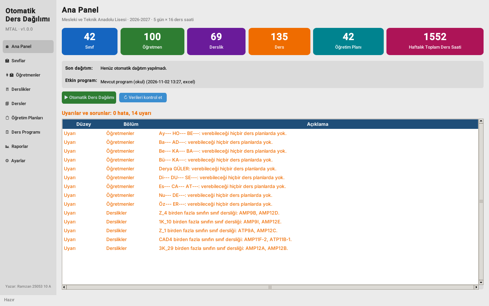

- Сколько классов, учителей, кабинетов, предметов и учебных планов, сколько всего часов в неделю.
- Результат последнего автоматического распределения и активный вариант расписания.
- **Список проблем в данных.** «Hata» (красное) — ошибки, без исправления которых расписание составить нельзя. «Uyarı» (оранжевое) — предупреждения, на которые стоит посмотреть.
- Кнопки «Otomatik Ders Dağılımı» и «Verileri kontrol et» (перепроверить данные).

### 3.2 Sınıflar — классы

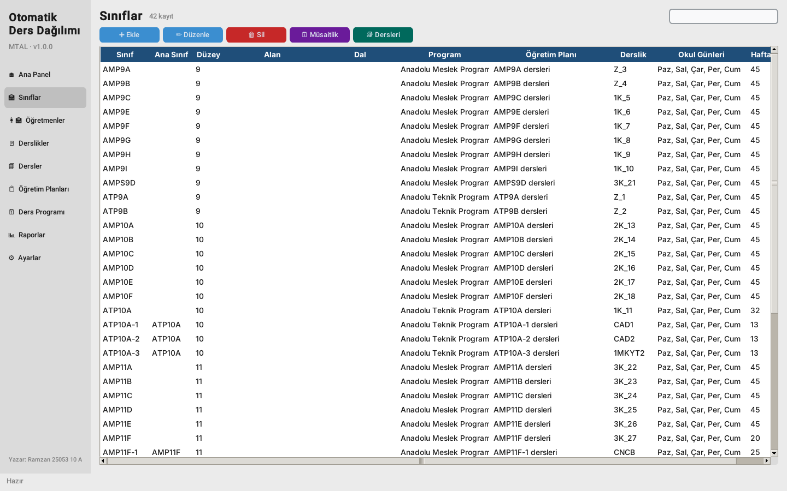

- **➕ Ekle / ✏️ Düzenle / 🗑 Sil** — добавить, изменить или удалить класс. Двойной щелчок по строке тоже открывает редактирование.
- В форме класса задаются:
  - название;
  - курс, направление (alan), специализация (dal) и программа (Anadolu Meslek / Anadolu Teknik);
  - учебный план и кабинет класса;
  - **дни учёбы** — дни на предприятии (İşletmede eğitim) не отмечаются;
  - число учеников и лимит уроков в день;
  - **«Grubu olduğu sınıf»** — если это подгруппа, например ATP10A-1, укажите основной класс ATP10A. Пока у подгруппы урок, у основного класса урока быть не может.
- **🗓 Müsaitlik** — недельная сетка класса, подробно в разделе 3.6.
- **📚 Dersleri** — все уроки класса:

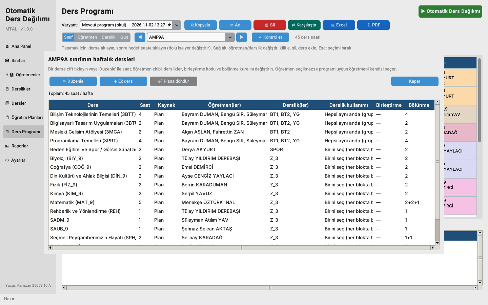

Двойной щелчок по уроку открывает его настройки:

| Поле | Что значит |
|---|---|
| Haftalık saat | Часов в неделю. 0 убирает предмет у этого класса. |
| Öğretmen(ler) | Учитель. Если выбрать нескольких, это **команда**: все ведут урок одновременно. Пусто — программа выберет учителя сама по специальности. |
| Derslik(ler) | Кабинеты урока. Пусто — по правилам предмета и кабинету класса. |
| Derslik kullanımı | «Hepsi aynı anda» — группы класса одновременно занимают все кабинеты. «Birini seç» — на каждое занятие выбирается один кабинет из списка. |
| Birleştirme kodu | Одинаковый код (например, B1) у нескольких классов или групп: урок идёт **вместе**, в одно время, у одного учителя. |
| Bölünme | Как делить часы на блоки подряд, например 2+2+1. Пусто — общее правило предмета. |

Кнопка **↩ Plana döndür** возвращает урок к учебному плану.

### 3.3 Öğretmenler — учителя

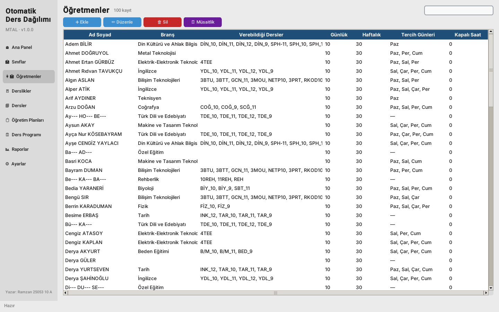

- Имя, **специальность (Branş)**: предметы этой специальности учитель может вести автоматически.
- Дополнительные предметы, которые он может вести.
- **Максимум уроков в день и в неделю** — жёсткое ограничение. Минимум в неделю — по желанию.
- **Максимум уроков подряд** и **предпочитаемые дни** — пожелания, а не жёсткие правила.
- Заметки, например должность (Alan Şefi, Atölye Şefi).
- **🗓 Müsaitlik** — часы, когда учитель недоступен.

### 3.4 Derslikler — кабинеты

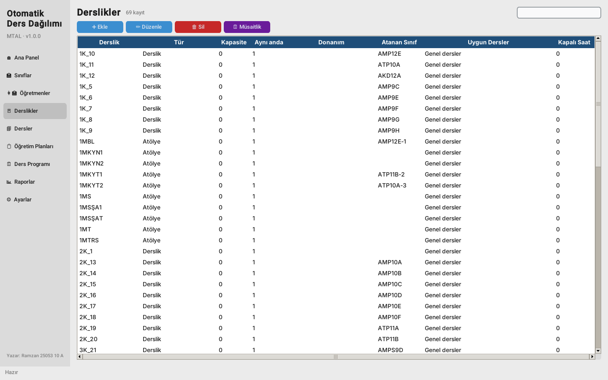

- Тип (Derslik, Bilgisayar Laboratuvarı, Atölye, Spor Salonu…), вместимость, оборудование.
- **«Aynı anda en fazla ders»** — сколько групп может одновременно заниматься в кабинете. Обычно 1, для большой мастерской (YG, 4PMA) — 2.
- Подходящие предметы и закрытые часы (🗓 Müsaitlik).

### 3.5 Dersler — предметы и Öğretim Planları — учебные планы

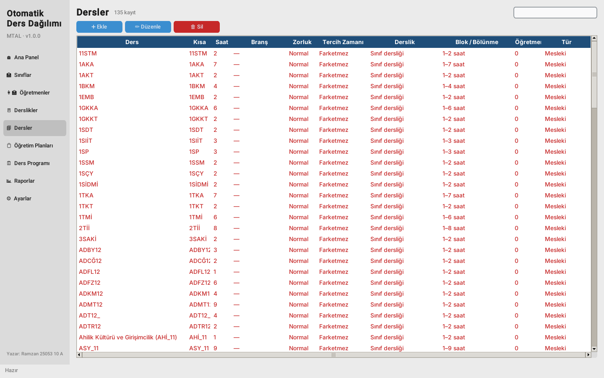

У предмета задаются:
- название, короткий код (виден в сетке), часы, специальность учителя;
- **сложность** (Normal / Zor / Çok zor): сложные предметы ставятся в начало дня;
- **физическая активность** (физкультура ставится в конец дня);
- предпочтительное время;
- тип кабинета и обязателен ли он;
- **правила блоков**: минимальный и максимальный блок, разрешённые, запрещённые и предпочитаемые варианты деления (например, `3+3+3; 2+2+2+3`), можно ли ставить два блока в один день;
- признаки: выборочный, профессиональный, **«Okul dışında»** (İşletmelerde Mesleki Eğitim: урок проходит на предприятии, учитель и кабинет не нужны).

**Öğretim Planları** — планы «предмет → часы» для каждого курса и специализации. Кнопка **📥 MEB** добавляет официальные планы MEB: 57 направлений, 336 планов, 9–12 классы.

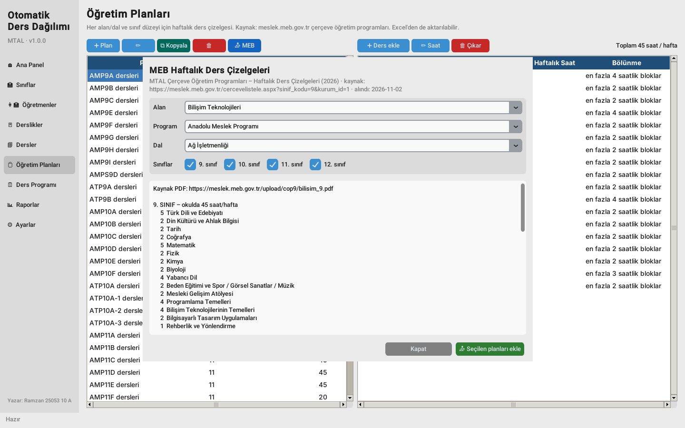

### 3.6 Сетка доступности (Müsaitlik)

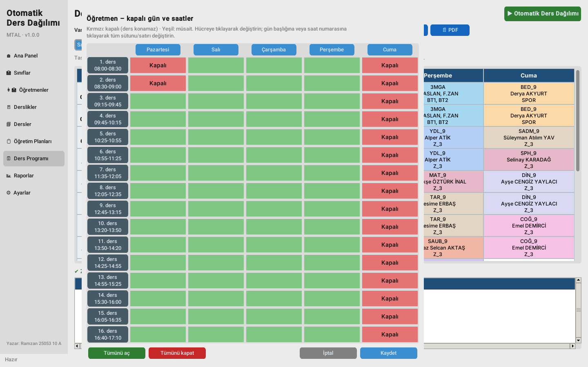

- Зелёная клетка — свободно, красная — **закрыто**: в это время уроков не будет.
- Щелчок по клетке переключает её, по названию дня — весь день, по номеру урока — весь ряд.
- «Tümünü aç» открывает всё, «Tümünü kapat» закрывает всё. Изменения сохраняются кнопкой **Kaydet**.

### 3.7 Ders Programı — расписание

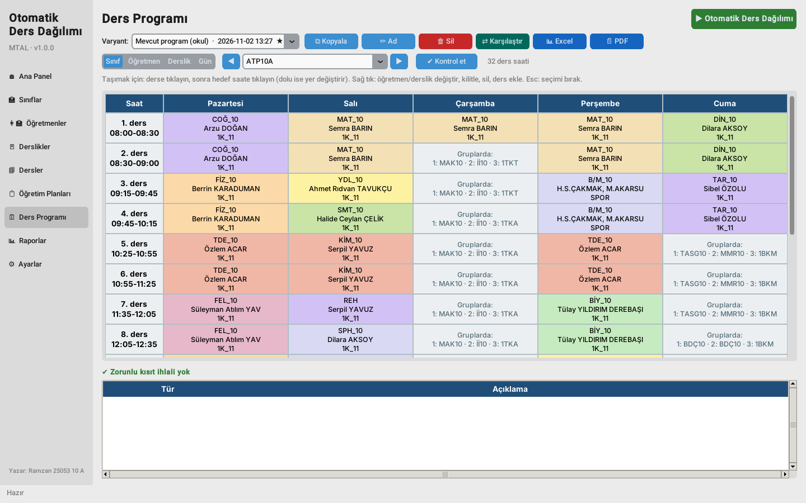

- **Varyant** — какой вариант расписания открыт. Звёздочка ★ отмечает активный.
- Режимы просмотра: **Sınıf** (класс), **Öğretmen** (учитель), **Derslik** (кабинет), **Gün** (весь день школы). Стрелки ◀ ▶ листают классы или учителей.
- Цвет ячейки обозначает предмет. В ячейке видны учитель (или команда) и кабинет.
- Серые клетки «Gruplarda» означают, что в это время у подгрупп класса свои уроки.
- Внизу список проверок. Красное — нарушение обязательного правила, щелчок по строке показывает нужный класс.

**Ручное редактирование:**
- **Перенести урок:** щёлкните по уроку (он выделится синей рамкой), затем по нужной клетке. Если клетка занята, уроки поменяются местами. Esc отменяет выбор.
- **Правый щелчок по уроку:**
  - сменить учителя или команду (✓ отмечает тех, кто может вести этот предмет);
  - сменить кабинет или кабинеты;
  - **🔒 закрепить** — при следующем автоматическом распределении урок останется на месте;
  - удалить час.
- **Правый щелчок по пустой клетке** (в режиме «Sınıf») — добавить урок.
- После каждого изменения программа сразу проверяет все правила. Конфликтные уроки обводятся красной рамкой.

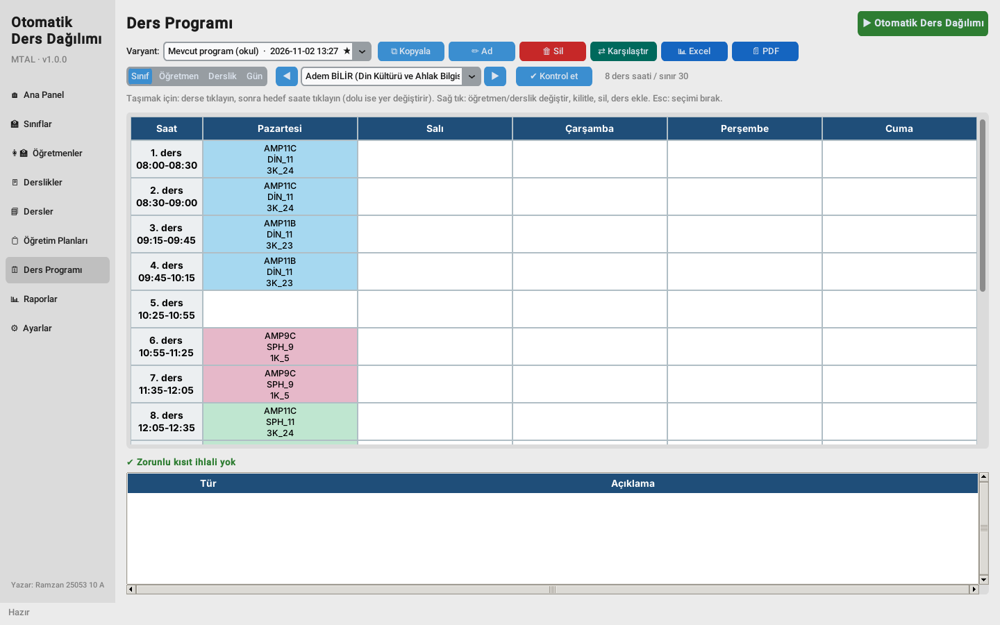 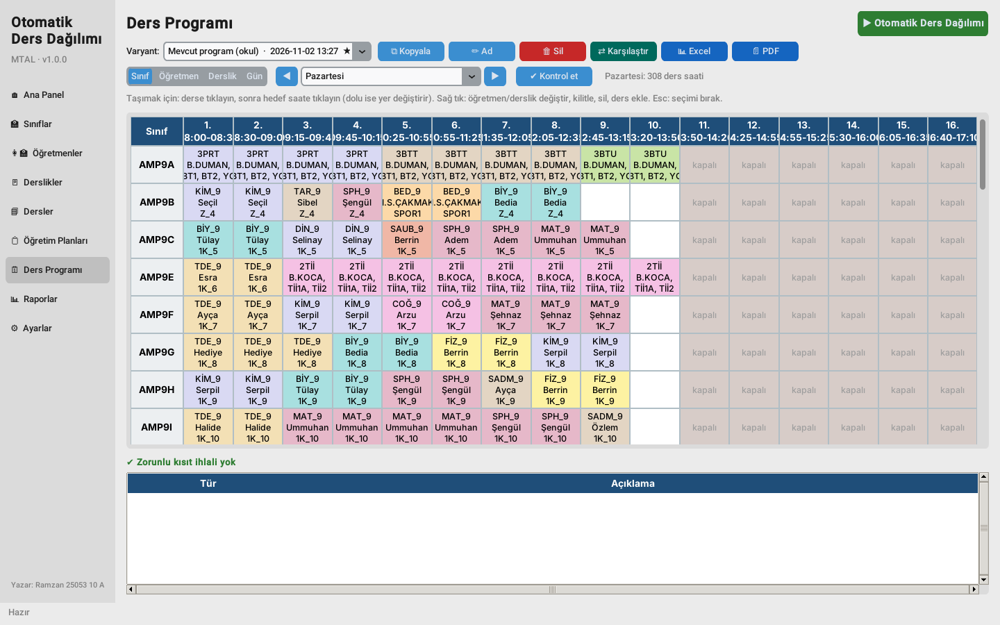

Кнопки сверху:
- **⧉ Kopyala** — копия варианта, удобно для экспериментов;
- **✏️ Ad** — переименовать вариант;
- **🗑 Sil** — удалить вариант;
- **⇄ Karşılaştır** — сравнить два варианта;
- **📊 Excel** — лист всей школы, отдельные листы по каждому классу, учителю и кабинету, отчёт о нагрузке;
- **📄 PDF** — для печати по классам, учителям или кабинетам.

### 3.8 Otomatik Ders Dağılımı — автоматическое составление

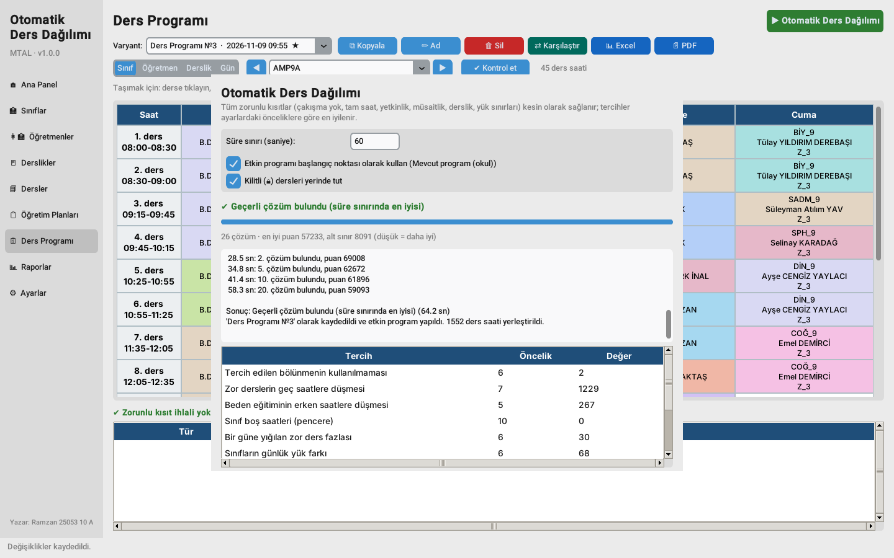

1. Нажмите зелёную кнопку **▶ Otomatik Ders Dağılımı**.
2. Задайте время на расчёт. Для школы с 1500+ часами разумно 5–10 минут (300–600 секунд).
3. Отметьте нужное:
   - **«Etkin programı başlangıç noktası olarak kullan»** — взять текущее расписание за основу и улучшить его. Рекомендуется.
   - **«Kilitli dersleri yerinde tut»** — не трогать закреплённые 🔒 уроки.
4. Нажмите **▶ Dağıtımı başlat**. Видно, сколько решений найдено и текущий «штраф»: чем меньше, тем лучше. **■ Durdur** останавливает расчёт, при этом лучшее найденное расписание сохраняется.
5. Результат сохраняется **новым вариантом**, старый не пропадает. Внизу окна таблица показывает, сколько нарушено каждое пожелание.

Если составить расписание невозможно, программа **ничего не сохраняет** и пишет причины, например: «*AMP12A sınıfının TDE dersi için 4 saat yerleştirilemiyor. Öğretmen X: kapalı saatleri… AMP12A sınıfının okul günleri yetersiz.*» Исправьте указанное и запустите снова.

### 3.9 Raporlar — отчёты

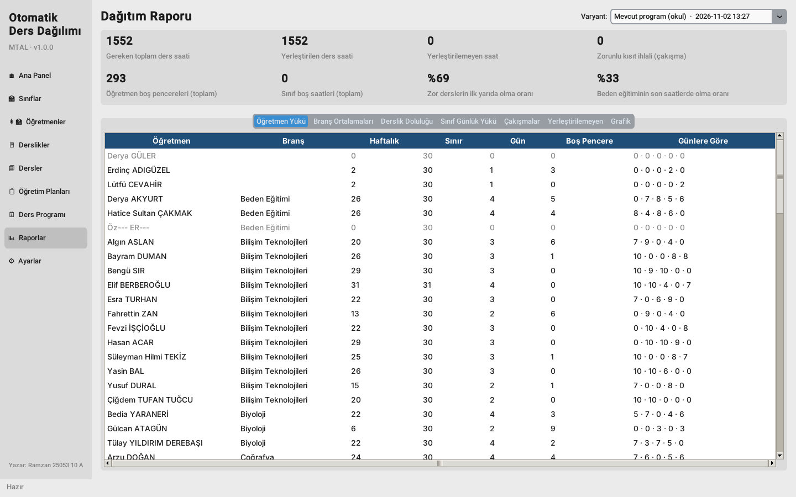

Для выбранного варианта показываются:
- сколько часов распределено и сколько нет, число конфликтов;
- окна у учителей и классов;
- доля сложных предметов в первой половине дня и физкультуры в конце дня;
- вкладки: нагрузка каждого учителя по дням, средние по специальностям, занятость кабинетов, нагрузка классов по дням, конфликты, нераспределённые часы, график.

### 3.10 Ayarlar — настройки и данные

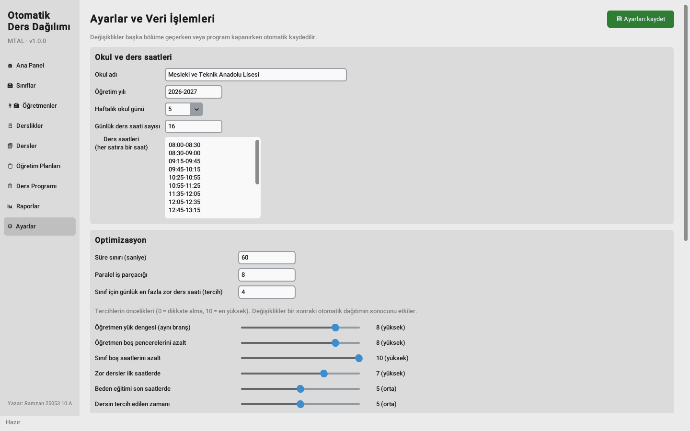

- Название школы, учебный год, **дней в неделю**, **уроков в день** и время каждого урока (по одной строке на урок).
- **Оптимизация:** время расчёта, число потоков, предел сложных уроков в день.
- **Приоритеты пожеланий** (ползунки 0–10). 0 — не учитывать, 10 — самое важное. Изменения влияют на следующий расчёт.
- Масштаб интерфейса и тема (светлая или тёмная), ежедневная резервная копия.
- Настройки **сохраняются автоматически**: при переходе в другой раздел или закрытии программы. Кнопка 💾 вверху сохраняет сразу.
- Кнопки работы с данными:
  - **🏫 Okul programını içe aktar** — загрузить расписания классов школы из Excel (формат «Sınıf Kodu …»; можно выбрать сразу файлы 9, 10, 11 и 12 классов). **Заменяет всю базу**, перед этим делается копия.
  - **📥 Excel'den içe aktar / 📤 Excel'e aktar / 📄 Boş şablon** — обмен справочниками через Excel. Можно выгрузить, поправить в Excel и загрузить обратно.
  - **🛟 Yedek al / ♻ Yedekten geri yükle** — создать резервную копию или восстановить данные из неё.
  - **🧪 Örnek veriler / 🗑 Tüm verileri sil** — загрузить демо-данные или удалить все данные.

---

## 4. Как программа считает расписание

### 4.1 Обычный порядок работы
1. **Проверка данных.** Ищутся ошибки во входных данных: у класса нет плана, у предмета нет учителя, часов больше, чем свободных клеток, учителю не хватает времени. Пока есть ошибки, расчёт не начнётся.
2. **Математическая модель.** Для каждого урока программа заводит переменные вида «да/нет»: «блок длиной L начинается в день d на уроке p», «урок ведёт учитель t», «занятие в кабинете r». Все правила записываются как уравнения и неравенства между ними.
3. **Решение.** Решатель Google OR-Tools CP-SAT сначала находит расписание, где выполнены все правила, а затем ищет расписания с меньшим штрафом, пока не кончится время.
4. **Независимая проверка.** Отдельная проверка ещё раз сверяет готовое расписание со всеми правилами. Она же запускается после каждого ручного изменения.

### 4.2 Обязательные правила — не нарушаются никогда
- У класса (и у основного класса вместе с его подгруппами) не больше одного урока одновременно.
- Учитель ведёт не больше одного урока одновременно. Объединённый урок считается одним.
- В кабинете одновременно не больше групп, чем указано в «Aynı anda en fazla ders».
- Каждый предмет получает **ровно** свои часы.
- Урок ведёт только учитель, который может вести этот предмет. Команда всегда целиком.
- Нет уроков в закрытые часы класса, учителя или кабинета и вне сетки школы.
- Урок проходит в подходящем кабинете, если кабинет для предмета обязателен.
- Не превышаются лимиты учителя в день и в неделю.
- Соблюдаются правила деления на блоки. Закреплённые 🔒 уроки остаются на месте.

### 4.3 Пожелания и штраф
Программа минимизирует **штраф**:

> **Штраф = Σ (приоритет × коэффициент × измеренное значение)**

| Пожелание | Что измеряется | Приоритет по умолчанию | Коэффициент |
|---|---|---|---|
| Баланс нагрузки учителей одной специальности | разница между самым загруженным и самым свободным | 8 | 25 |
| Меньше окон у учителей | пустые уроки между уроками учителя | 8 | 12 |
| Меньше окон у классов | пустые уроки у класса | 10 | 30 |
| Сложные предметы в начале дня | на каком уроке стоит сложный предмет | 7 | 2 |
| Физкультура в конце дня | насколько физкультура далеко от конца дня | 5 | 2 |
| Предпочтительное время предмета | отклонение от «утро» или «после обеда» | 5 | 2 |
| Не больше N сложных уроков в день | превышение лимита | 6 | 15 |
| Равномерная нагрузка класса по дням | разница между самым тяжёлым и самым лёгким днём | 6 | 8 |
| Равномерная нагрузка учителя по дням | уроки в самый загруженный день | 3 | 3 |
| Не слишком много уроков подряд у учителя | превышение лимита подряд | 5 | 10 |
| Предпочитаемые дни учителя | уроки в другие дни | 4 | 4 |
| Предпочитаемое деление на блоки | предпочитаемый вариант не использован | 6 | 20 |

**Пример.** Если у учителя за день 2 окна, штраф = 8 × 12 × 2 = **192**. Если математика стоит на 6-м уроке вместо 1-го, штраф = 7 × 2 × 5 × 2 (сложность) = **140**. Программа ищет расписание, где сумма всех таких штрафов минимальна. Приоритеты меняются в «Ayarlar».

### 4.4 Результат на данных школы
Ваше текущее расписание (1552 часа, 33 класса и 9 подгрупп, 16 уроков по 30 минут) **проходит все обязательные правила**. Значит, программа правильно описывает правила школы. Вот что дала оптимизация с текущим расписанием в качестве основы:

| Показатель | Текущее | Оптимизированное |
|---|---|---|
| Конфликтов | 0 | 0 |
| Окна у учителей (по 30 минут) | 293 | 100 |
| Сложные предметы в первой половине дня | 69 % | 79 % |
| Физкультура в конце дня | 33 % | 56 % |

Оба расписания лежат в `docs/okul/` (Excel), а описание алгоритма для директора — в PDF `docs/okul/Algoritma_ve_Hesaplama.pdf`.

---

## 5. Частые вопросы

**Как поменять звонки или число уроков?** Ayarlar → «Günlük ders saati sayısı» и список времени уроков, по одной строке на урок.

**Учитель заболел или не может в пятницу.** Öğretmenler → выберите учителя → 🗓 Müsaitlik → закройте нужные клетки → запустите автоматическое распределение со «стартом от текущего расписания». Уроки, которые трогать нельзя, сначала закрепите 🔒.

**Как сделать, чтобы конкретный урок не двигался?** Правый щелчок по уроку → «Kilitle».

**Как вернуть прежнее расписание?** Выберите нужный вариант в списке «Varyant»: он станет активным. Варианты не удаляются, пока вы сами их не удалите.

**Где резервные копии?** В папке `backups`. Восстановление: Ayarlar → ♻ Yedekten geri yükle.

**Расчёт долгий.** Первое расписание для всей школы появляется примерно через 35 секунд, дальше оно улучшается. Можно нажать **■ Durdur**: лучшее найденное расписание сохранится.

---

Автор: Ramzan 25053 10 A
