# Otomatik Ders Dağılım Programı — Kullanım Kılavuzu

Program, Mesleki ve Teknik Anadolu Lisesi (MTAL) için ders programını otomatik olarak hazırlar. Dersleri sınıflara, öğretmenlere, dersliklere, günlere ve saatlere okulun tüm kurallarına uyarak dağıtır. Kullanmak için programlama bilgisi gerekmez.

Rusça sürüm: [INSTRUKCIYA_RU.md](INSTRUKCIYA_RU.md)

---

## 1. Kurulum ve çalıştırma (Windows 10/11)

1. https://www.python.org/downloads/ adresinden **Python 3.11 veya daha yenisini** kurun. Kurulumda şunları işaretleyin:
   - **Add python.exe to PATH**;
   - **tcl/tk and IDLE** (genelde varsayılan olarak işaretlidir).
2. https://github.com/Ramzan202/dersler sayfasında **Code → Download ZIP** ile programı indirin ve bir klasöre (ör. Masaüstü) çıkarın.
3. **`run.bat`** dosyasına çift tıklayın.

İlk çalıştırmada `run.bat`, `venv` klasörünü oluşturur ve gerekli kütüphaneleri indirir. Bunun için internet gerekir ve birkaç dakika sürer. Sonraki açılışlarda program hemen açılır.

Hata mesajları:

| Mesaj | Ne yapılmalı |
|---|---|
| "Python 3.11 veya daha yeni bir sürüm bulunamadı" | Python kurulu değil veya PATH'e eklenmemiş. Python'u "Add python.exe to PATH" işaretli olarak yeniden kurun. |
| "tkinter yok" | Python kurulumunda **Modify** → **tcl/tk** işaretleyin, `venv` klasörünü silip `run.bat`'ı yeniden çalıştırın. |
| "OR-Tools yüklenemedi" / `abseil_dll.dll` | Programı kapatıp `run.bat`'ı yeniden çalıştırın; eksik bileşenler otomatik kurulur. Olmazsa https://aka.ms/vs/17/release/vc_redist.x64.exe kurun ve bilgisayarı yeniden başlatın. |
| Diğer hatalar | Ayrıntılar `data\hata_kaydi.log` dosyasına yazılır. |

---

## 2. Veriler nerede?

- `data/database.db` — tüm veritabanı: sınıflar, öğretmenler, dersler, derslikler, ayarlar ve program varyantları. Depoda okulun verileriyle hazır gelir.
- **Her değişiklik anında kaydedilir**; ayrıca "Kaydet" düğmesine basmak gerekmez.
- `backups/` — yedekler. Program her gün ve her riskli işlemden (içe aktarma, geri yükleme, silme) önce otomatik yedek alır.
- `exports/` — Excel ve PDF çıktılarının varsayılan klasörü.

---

## 3. Bölümler

Sol tarafta menü, pencerenin altında son işlemi gösteren durum satırı vardır.

### 3.1 Ana Panel

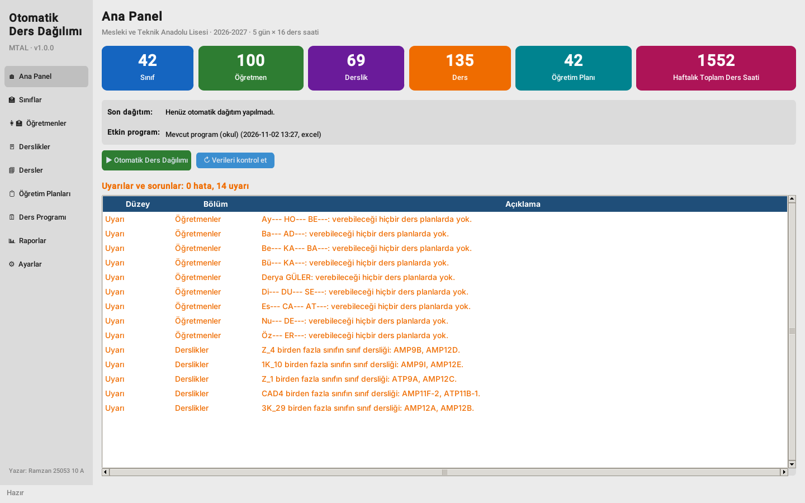

- Sınıf, öğretmen, derslik, ders ve öğretim planı sayısı; haftalık toplam ders saati.
- Son otomatik dağıtımın sonucu ve etkin program varyantı.
- **Veri sorunları listesi.** "Hata" (kırmızı) düzeltilmeden program hazırlanamaz. "Uyarı" (turuncu) kontrol edilmesi önerilen durumlardır.
- "Otomatik Ders Dağılımı" ve "Verileri kontrol et" düğmeleri.

### 3.2 Sınıflar

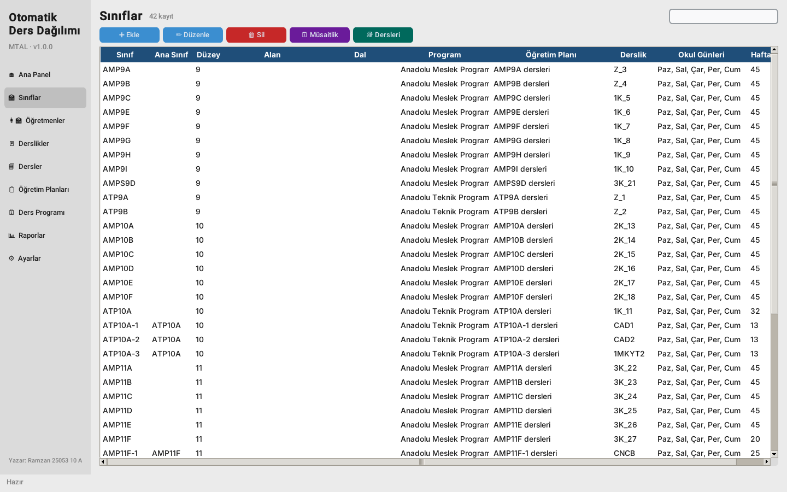

- **➕ Ekle / ✏️ Düzenle / 🗑 Sil** — sınıf ekle, düzenle veya sil. Satıra çift tıklamak da düzenlemeyi açar.
- Sınıf formunda şunlar girilir:
  - ad;
  - düzey, alan, dal ve program (Anadolu Meslek / Anadolu Teknik);
  - öğretim planı ve sınıf dersliği;
  - **okul günleri** — işletmede eğitim günleri işaretlenmez;
  - öğrenci sayısı ve günlük en fazla ders;
  - **"Grubu olduğu sınıf"** — şube grubu ise (ör. ATP10A-1) ana sınıf (ATP10A) seçilir. Grup dersi sırasında ana sınıfın başka dersi olamaz.
- **🗓 Müsaitlik** — sınıfın haftalık tablosu, ayrıntılar bölüm 3.6'da.
- **📚 Dersleri** — sınıfın tüm dersleri:

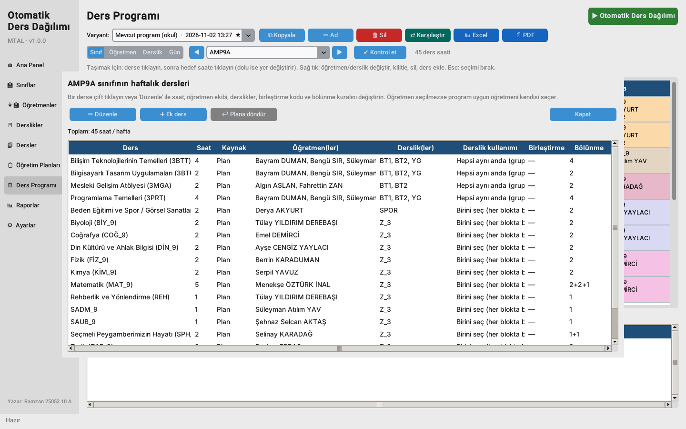

Derse çift tıklayınca ayarları açılır:

| Alan | Anlamı |
|---|---|
| Haftalık saat | Haftalık ders saati. 0 = bu sınıfın programından çıkar. |
| Öğretmen(ler) | Öğretmen. Birden fazla seçilirse **ekiptir**: hepsi derse aynı anda girer. Boş bırakılırsa program branşa göre öğretmeni kendisi seçer. |
| Derslik(ler) | Dersin derslikleri. Boş = dersin ve sınıfın ayarlarına göre otomatik. |
| Derslik kullanımı | "Hepsi aynı anda" — sınıfın grupları tüm derslikleri birlikte kullanır. "Birini seç" — her blokta listeden bir derslik seçilir. |
| Birleştirme kodu | Aynı kodu (ör. B1) taşıyan sınıflar veya gruplar bu dersi **birlikte**, aynı saatte, aynı öğretmenle yapar. |
| Bölünme | Saatlerin art arda bloklara bölünmesi, ör. 2+2+1. Boş = dersin genel kuralı. |

**↩ Plana döndür** düğmesi dersi öğretim planındaki haline getirir.

### 3.3 Öğretmenler

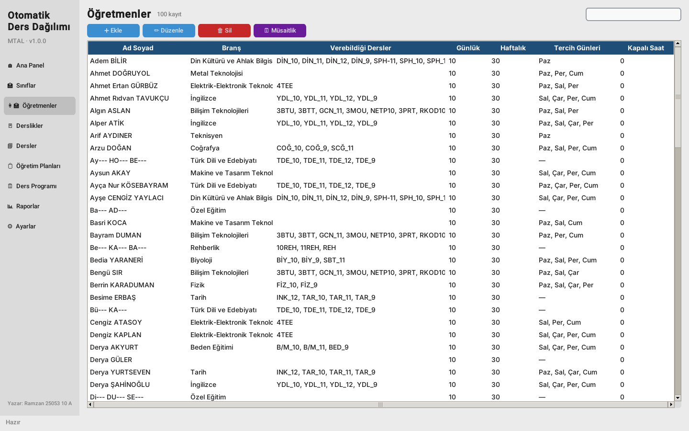

- Ad soyad ve **branş**: bu branştaki dersleri otomatik olarak verebilir.
- Ayrıca verebildiği dersler.
- **Günlük ve haftalık en fazla ders** — zorunlu sınır. Haftalık en az ders isteğe bağlıdır.
- **Art arda en fazla ders** ve **tercih ettiği günler** — zorunlu kural değil, tercihtir.
- Notlar (ör. görev: Alan Şefi, Atölye Şefi).
- **🗓 Müsaitlik** — öğretmenin derse giremeyeceği saatler.

### 3.4 Derslikler

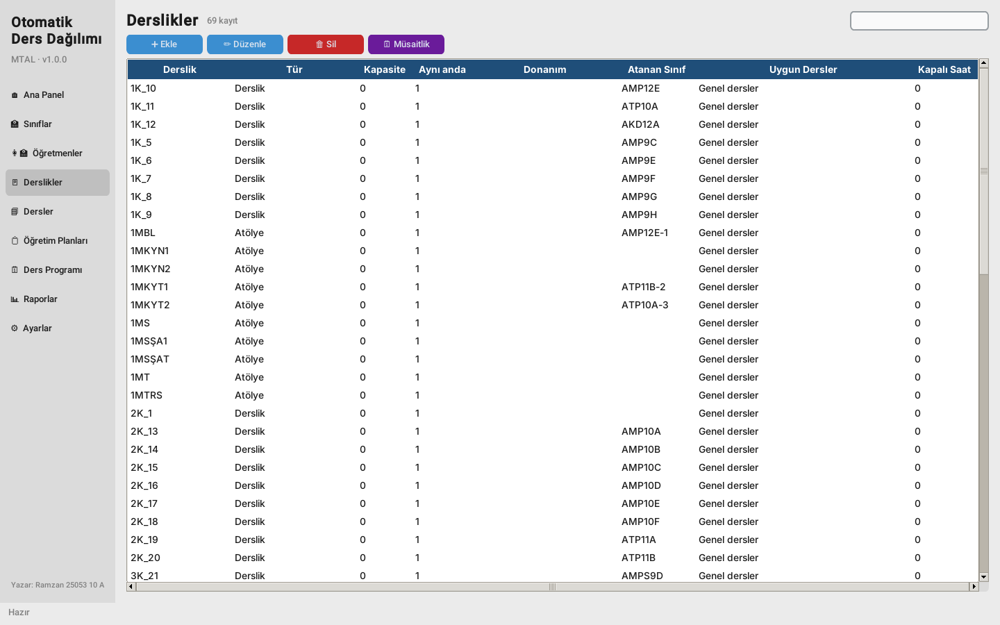

- Tür (Derslik, Bilgisayar Laboratuvarı, Atölye, Spor Salonu…), kapasite, donanım.
- **"Aynı anda en fazla ders"** — derslikte aynı saatte kaç grubun ders yapabileceği. Genelde 1; büyük atölyede (YG, 4PMA) 2.
- Uygun dersler ve kapalı saatler (🗓 Müsaitlik).

### 3.5 Dersler ve Öğretim Planları

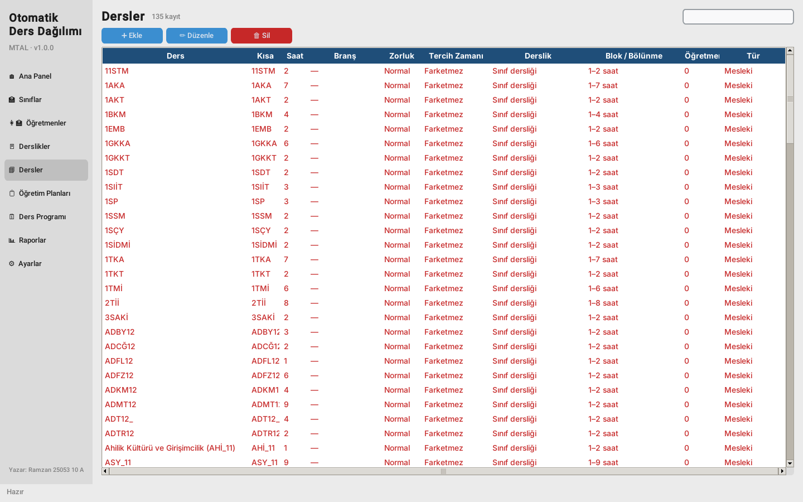

Derste şunlar ayarlanır:
- ad, kısa kod (tabloda görünür), saat ve öğretmen branşı;
- **zorluk** (Normal / Zor / Çok zor): zor dersler günün ilk saatlerine konur;
- **fiziksel etkinlik**: beden eğitimi günün sonuna konur;
- tercih edilen zaman;
- derslik türü ve zorunlu olup olmadığı;
- **blok kuralları**: en kısa ve en uzun blok; izin verilen, yasaklı ve tercih edilen bölünmeler (ör. `3+3+3; 2+2+2+3`); aynı güne birden fazla blok konup konamayacağı;
- özellikler: seçmeli, mesleki, **"Okul dışında"** (İşletmelerde Mesleki Eğitim: işletmede yapılır, öğretmen ve derslik gerekmez).

**Öğretim Planları**, her düzey ve dal için "ders → haftalık saat" listesidir. **📥 MEB** düğmesi resmi MEB çizelgelerini ekler: 57 alan, 336 plan, 9–12. sınıflar.

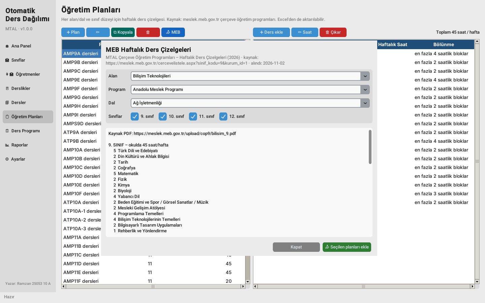

### 3.6 Müsaitlik tablosu

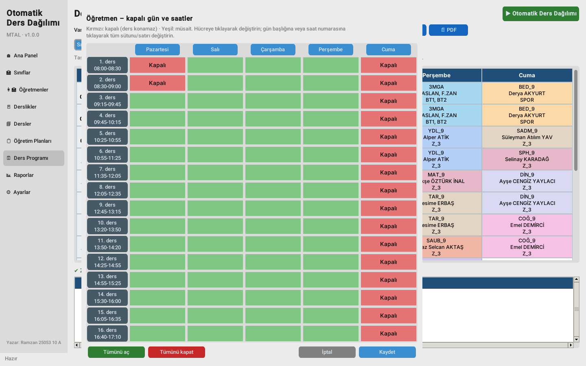

- Yeşil = müsait, kırmızı = **kapalı**: o saate ders konmaz.
- Hücreye tıklamak hücreyi, gün başlığına tıklamak tüm günü, ders numarasına tıklamak tüm satırı değiştirir.
- "Tümünü aç" her şeyi açar, "Tümünü kapat" her şeyi kapatır. Değişiklikler **Kaydet** ile kaydedilir.

### 3.7 Ders Programı

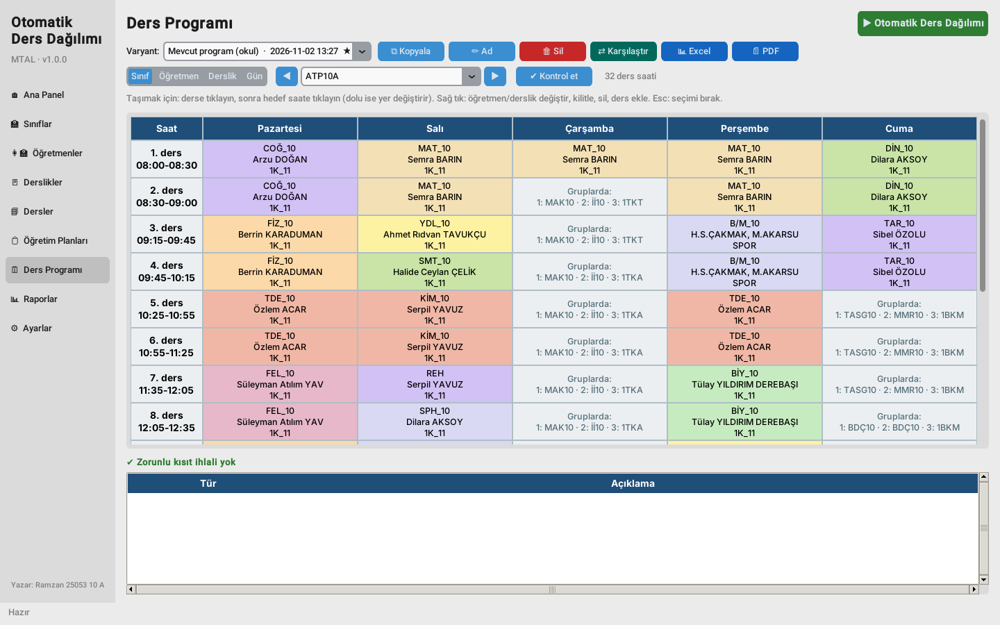

- **Varyant** — açık olan program varyantı. ★ etkin varyantı gösterir.
- Görünümler: **Sınıf**, **Öğretmen**, **Derslik**, **Gün** (okulun tüm günü). ◀ ▶ okları sınıflar veya öğretmenler arasında gezinir.
- Hücre rengi dersi gösterir. Hücrede öğretmen (veya ekip) ve derslik yazar.
- Gri "Gruplarda" hücreleri, o saatte sınıfın gruplarının kendi derslerinde olduğunu gösterir.
- Altta kontrol listesi vardır. Kırmızı satır zorunlu kural ihlalidir; satıra tıklayınca ilgili sınıf açılır.

**Elle düzenleme:**
- **Ders taşıma:** derse tıklayın (mavi çerçeve), sonra hedef saate tıklayın. Hedef doluysa iki ders yer değiştirir. Esc seçimi iptal eder.
- **Derse sağ tık:**
  - öğretmen veya ekibi değiştir (✓ = bu derse yetkili);
  - derslik veya derslikleri değiştir;
  - **🔒 kilitle** — sonraki otomatik dağıtımda ders yerinde kalır;
  - saati sil.
- **Boş hücreye sağ tık** ("Sınıf" görünümünde) — ders ekle.
- Her değişiklikten sonra program tüm kuralları hemen kontrol eder. Çakışan dersler kırmızı çerçeveyle gösterilir.

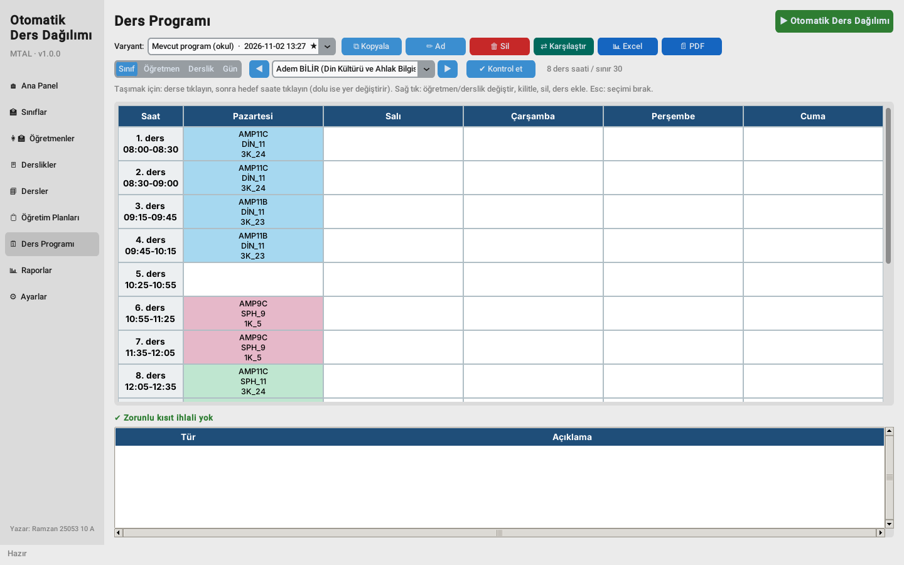 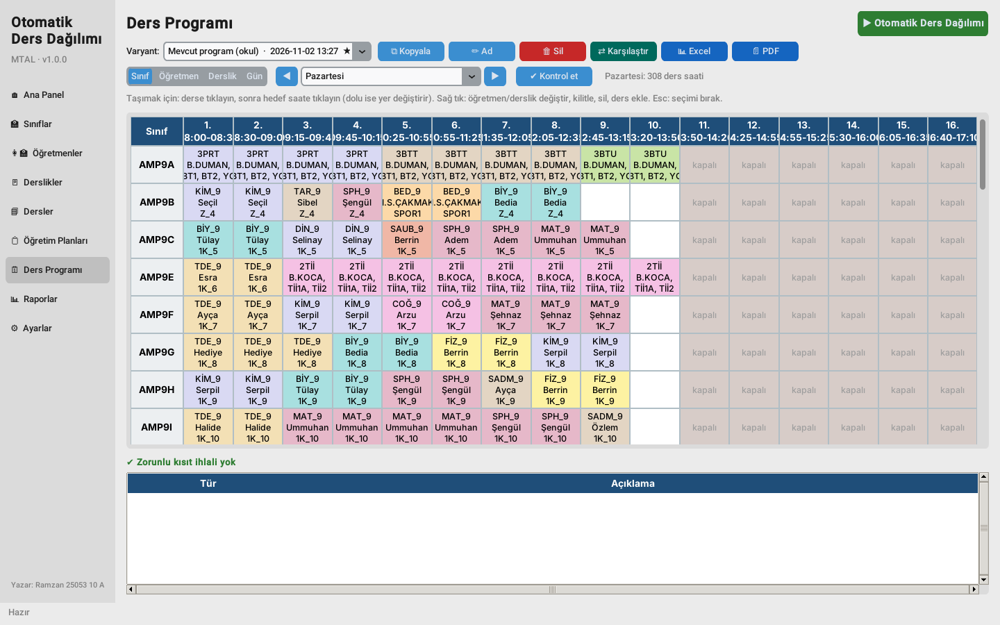

Üstteki düğmeler:
- **⧉ Kopyala** — varyantın kopyası; denemeler için uygundur;
- **✏️ Ad** — varyantı yeniden adlandır;
- **🗑 Sil** — varyantı sil;
- **⇄ Karşılaştır** — iki varyantı karşılaştır;
- **📊 Excel** — okul sayfası, her sınıf, öğretmen ve derslik için ayrı sayfalar, öğretmen yük raporu;
- **📄 PDF** — sınıf, öğretmen veya derslik programlarının çıktısı.

### 3.8 Otomatik Ders Dağılımı

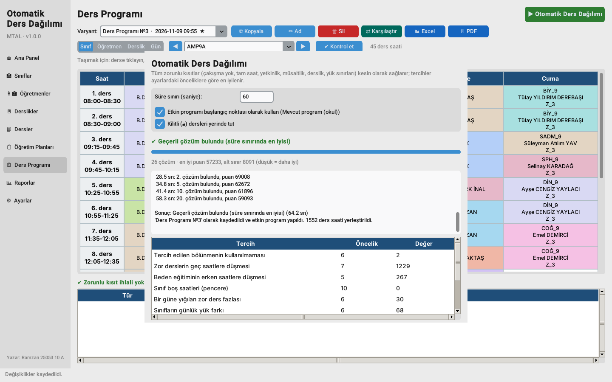

1. Yeşil **▶ Otomatik Ders Dağılımı** düğmesine basın.
2. Süre sınırını girin. 1500'den fazla ders saati olan bir okul için 5–10 dakika (300–600 saniye) uygundur.
3. İsterseniz işaretleyin:
   - **"Etkin programı başlangıç noktası olarak kullan"** — mevcut programdan başlayıp iyileştirir. Önerilir.
   - **"Kilitli dersleri yerinde tut"** — kilitli 🔒 derslere dokunmaz.
4. **▶ Dağıtımı başlat** düğmesine basın. Ekranda bulunan çözüm sayısı ve ceza puanı görünür (düşük = daha iyi). **■ Durdur** hesaplamayı durdurur; o ana kadar bulunan en iyi program kaydedilir.
5. Sonuç **yeni bir varyant** olarak kaydedilir; eski program kaybolmaz. Pencerenin altındaki tablo her tercihin ne kadar karşılanmadığını gösterir.

Program hazırlanamıyorsa **hiçbir şey kaydedilmez** ve nedenleri yazılır, örneğin: "*AMP12A sınıfının TDE dersi için 4 saat yerleştirilemiyor. Öğretmen X: kapalı saatleri… AMP12A sınıfının okul günleri yetersiz.*" Belirtilen kaydı düzeltip yeniden çalıştırın.

### 3.9 Raporlar

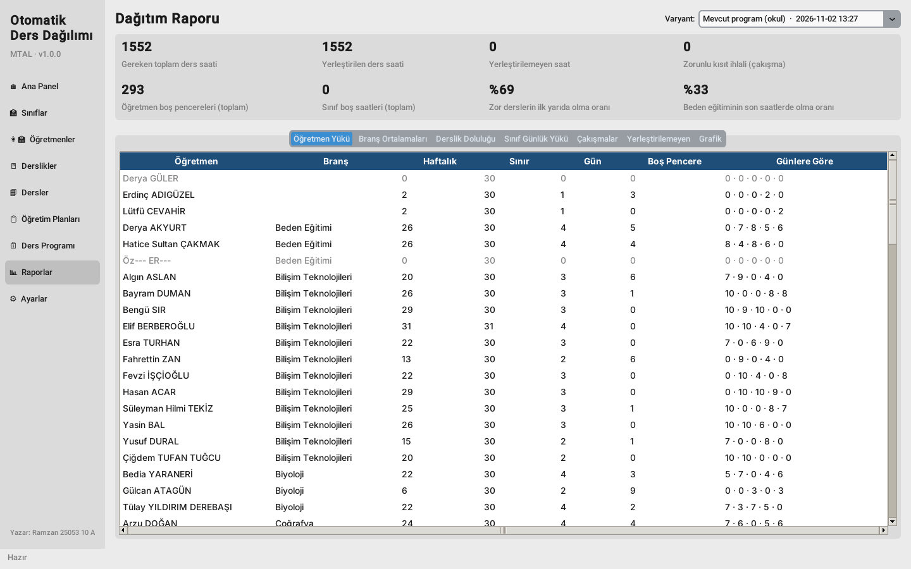

Seçilen varyant için şunlar gösterilir:
- yerleşen ve yerleşmeyen ders saati, çakışma sayısı;
- öğretmen ve sınıf boş pencereleri;
- zor derslerin günün ilk yarısında, beden eğitiminin son saatlerde olma oranı;
- sekmeler: öğretmenlerin günlere göre yükü, branş ortalamaları, derslik doluluğu, sınıfların günlük yükü, çakışmalar, yerleşmeyen saatler, grafik.

### 3.10 Ayarlar

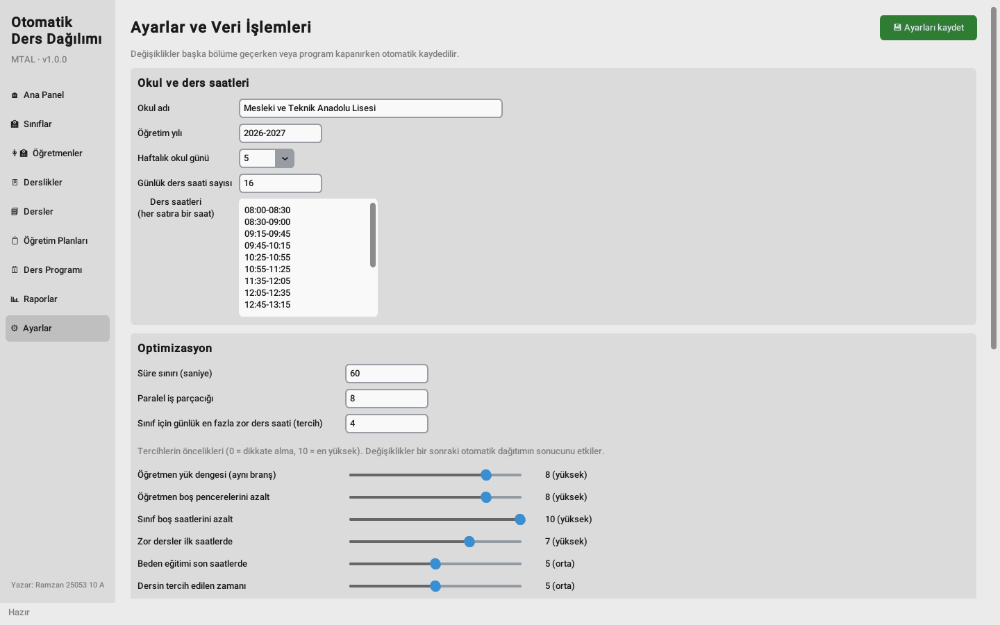

- Okul adı, öğretim yılı, **haftalık gün sayısı**, **günlük ders sayısı** ve her dersin saati (her satıra bir saat).
- **Optimizasyon:** süre sınırı, iş parçacığı sayısı, günlük zor ders sınırı.
- **Tercih öncelikleri** (0–10 kaydırıcılar). 0 = dikkate alma, 10 = en önemli. Değişiklikler bir sonraki dağıtımı etkiler.
- Arayüz ölçeği ve tema (açık veya koyu), günlük otomatik yedek.
- Ayarlar **otomatik kaydedilir**: başka bölüme geçerken veya program kapanırken. Üstteki 💾 düğmesi hemen kaydeder.
- Veri işlemleri:
  - **🏫 Okul programını içe aktar** — okulun sınıf programlarını (Excel, "Sınıf Kodu …" biçimi; 9, 10, 11 ve 12. sınıf dosyaları birlikte seçilebilir) aktarır. **Tüm veritabanını değiştirir**; öncesinde yedek alınır.
  - **📥 Excel'den içe aktar / 📤 Excel'e aktar / 📄 Boş şablon** — tanımları Excel ile alıp vermek için. Excel'e aktarıp düzenleyebilir ve geri yükleyebilirsiniz.
  - **🛟 Yedek al / ♻ Yedekten geri yükle** — yedek oluşturur veya verileri yedekten geri yükler.
  - **🧪 Örnek veriler / 🗑 Tüm verileri sil** — örnek verileri yükler veya tüm verileri siler.

---

## 4. Program nasıl hesaplar?

### 4.1 Adımlar
1. **Veri kontrolü.** Giriş verilerindeki hatalar aranır: planı olmayan sınıf, öğretmeni olmayan ders, boş saatten fazla ders, zamanı yetmeyen öğretmen gibi. Hata varsa hesaplama başlamaz.
2. **Matematiksel model.** Her ders için "evet/hayır" değişkenleri tanımlanır: "L saatlik blok d günü p. derste başlar", "dersi t öğretmeni verir", "ders r dersliğindedir". Tüm kurallar bu değişkenler arasında eşitlik ve eşitsizlik olarak yazılır.
3. **Çözüm.** Google OR-Tools CP-SAT çözücüsü önce tüm kuralları sağlayan bir program bulur, sonra süre bitene kadar ceza puanı daha düşük programlar arar.
4. **Bağımsız doğrulama.** Ayrı bir denetleyici, bulunan programı tüm kurallara karşı yeniden kontrol eder. Aynı kontrol her elle değişiklikten sonra da çalışır.

### 4.2 Zorunlu kurallar — asla ihlal edilmez
- Sınıfın (ve ana sınıf ile gruplarının) aynı saatte en fazla bir dersi olur.
- Öğretmen aynı saatte en fazla bir derse girer. Birleştirilmiş ders tek ders sayılır.
- Derslikte aynı saatte "Aynı anda en fazla ders" sayısından fazla grup olmaz.
- Her ders **tam olarak** haftalık saati kadar yerleşir.
- Dersi yalnızca bu dersi verebilen öğretmen verir. Ekip her zaman eksiksizdir.
- Sınıfın, öğretmenin ve dersliğin kapalı saatlerine ve okulun çalışma saatleri dışına ders konmaz.
- Derslik zorunluysa ders uygun derslikte yapılır.
- Öğretmenin günlük ve haftalık sınırları aşılmaz.
- Blok bölünme kurallarına uyulur. Kilitli 🔒 dersler yerinde kalır.

### 4.3 Tercihler ve ceza puanı
Program şu **ceza puanını** en küçük yapmaya çalışır:

> **Ceza = Σ (öncelik × katsayı × ölçülen değer)**

| Tercih | Ölçülen değer | Varsayılan öncelik | Katsayı |
|---|---|---|---|
| Aynı branştaki öğretmenler arası yük dengesi | en yoğun ile en hafif öğretmen arasındaki fark | 8 | 25 |
| Öğretmen boş pencerelerini azalt | öğretmenin dersleri arasındaki boş saatler | 8 | 12 |
| Sınıf boş saatlerini azalt | sınıfın gün içindeki boş saatleri | 10 | 30 |
| Zor dersler ilk saatlerde | zor dersin kaçıncı saatte olduğu | 7 | 2 |
| Beden eğitimi son saatlerde | günün sonuna uzaklığı | 5 | 2 |
| Dersin tercih edilen zamanı | sabah / öğleden sonra tercihinden sapma | 5 | 2 |
| Bir günde çok fazla zor ders olmasın | sınırı aşan zor ders saati | 6 | 15 |
| Sınıfın günlük yük dengesi | en yoğun ve en hafif gün arasındaki fark | 6 | 8 |
| Öğretmenin günlük yük dengesi | en yoğun gündeki ders sayısı | 3 | 3 |
| Öğretmen için art arda çok ders olmasın | art arda sınırını aşan saatler | 5 | 10 |
| Öğretmenin tercih ettiği günler | diğer günlerdeki dersleri | 4 | 4 |
| Tercih edilen blok bölünmesi | tercih edilen bölünmenin kullanılmaması | 6 | 20 |

**Örnek.** Bir öğretmenin bir günde 2 boş saati varsa ceza = 8 × 12 × 2 = **192**. Matematik 1. saat yerine 6. saate konursa ceza = 7 × 2 × 5 × 2 (zorluk) = **140**. Program bu cezaların toplamını en küçük yapan yerleşimi arar. Öncelikler "Ayarlar" bölümünden değiştirilebilir.

### 4.4 Okul verileriyle sonuç
Okulun mevcut ders programı (1552 ders saati, 33 sınıf ve 9 şube grubu, 30 dakikalık 16 ders) **tüm zorunlu kuralları sağlıyor**. Yani program okulun kurallarını doğru tanımlıyor. Mevcut programdan başlayan optimizasyonun sonucu:

| Ölçüt | Mevcut | Optimize edilmiş |
|---|---|---|
| Çakışma | 0 | 0 |
| Öğretmen boş pencereleri (30 dk) | 293 | 100 |
| Zor derslerin günün ilk yarısında olma oranı | %69 | %79 |
| Beden eğitiminin son saatlerde olma oranı | %33 | %56 |

İki program da `docs/okul/` klasöründe (Excel). Yönetim için algoritma açıklaması: `docs/okul/Algoritma_ve_Hesaplama.pdf`.

---

## 5. Sık sorulan sorular

**Zil saatlerini veya ders sayısını nasıl değiştiririm?** Ayarlar → "Günlük ders saati sayısı" ve ders saatleri listesi (her satıra bir saat).

**Öğretmen hasta veya cuma günü gelemiyor.** Öğretmenler → öğretmeni seçin → 🗓 Müsaitlik → ilgili saatleri kapatın → "mevcut programdan başla" seçeneğiyle otomatik dağıtımı çalıştırın. Değişmemesi gereken dersleri önce 🔒 kilitleyin.

**Bir dersin yerinin değişmemesini nasıl sağlarım?** Derse sağ tık → "Kilitle".

**Eski programa nasıl dönerim?** "Varyant" listesinden istediğiniz varyantı seçin; etkin varyant olur. Varyantlar siz silmedikçe silinmez.

**Yedekler nerede?** `backups` klasöründe. Geri yükleme: Ayarlar → ♻ Yedekten geri yükle.

**Hesaplama uzun sürüyor.** Tüm okul için ilk program yaklaşık 35 saniyede bulunur, sonrasında iyileştirilir. **■ Durdur** düğmesine basabilirsiniz; bulunan en iyi program kaydedilir.

---

Hazırlayan: Ramzan 25053 10 A
